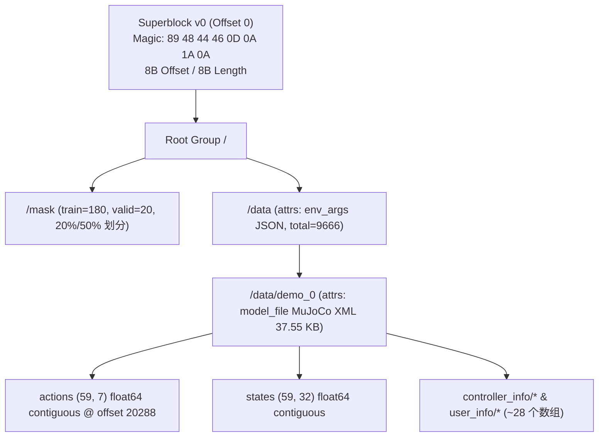

# HDF5 / robomimic 底层架构与二进制机制深度研究

> 基于真实 Stanford robomimic 官方开源样本 `v1.5/lift/ph/demo_v15.hdf5`（35.00 MB 单文件，200 条 Franka Panda Lift 轨迹，9,666 步）以及本仓库 [hdf5.py](../src/embodied_formats/deep_dive/hdf5.py) 的实测输出（运行 `uv run edlab deep hdf5 -n 200` 或在 VS Code 中按 `F5` 选择 `3. Deep Dive: HDF5 / robomimic` 可一键复现）。

---

## 1. 整体架构：单文件树状容器与自包含元数据

- **文件系统**：极致单文件封装（**1 个文件 / 35.00 MB**，外部零非二进制元数据文件）。
- **核心优势与局限**：单机顺序/随机切片达微秒级；但缺乏行业统一键名 Schema（robomimic 用 `data/demo_i/obs`，ALOHA 用单轨迹文件 `observations/images`），且单文件受 HDF5 全局锁制约，不支持视频帧间压缩。

---

## 2. Superblock 二进制头与惊人的 B-Tree 元数据开销

对 `demo_v15.hdf5` 偏移 `0` 处原始字节的解析结果：
- **Magic Signature**：`89 48 44 46 0D 0A 1A 0A`（`\x89HDF\r\n\x1a\n`），校验通过。
- **Superblock Version**：`v0`，`size_of_offsets = 8`，`size_of_lengths = 8`，`group_leaf_node_k = 4`，`group_internal_node_k = 16`。
- **EOF 闭合校验**：`eof_address = 36,699,586 == 文件实际字节数`。

### 存储账本实测（反直觉的关键发现）

| 统计项 | 实测值 | 说明 |
| --- | ---: | --- |
| Demo 总数 / 总步数 | `200` 条 / `9,666` 步 | 单条长度：`min=36, median=48, max=64` |
| 文件内 Dataset 总数 | **`6,008` 个** | 每条 Demo 拆成 ~30 个独立小数组 |
| 存储布局分布 | `6,008 contiguous / 0 chunked` | 100% 连续无压缩存储（`1.00x`） |
| **所有张量有效载荷总和** | **`11.04 MB`** | 仅占文件体积 **`31.53%`** |
| **B-Tree + Heap + 内嵌 Attributes 开销** | **`23.96 MB`** | 占整个文件 **`68.47%`！** |

> **为什么元数据开销高达 68.5%？**
> 1. 6,008 个独立小 Dataset 产生了大量 HDF5 B-Tree 节点、Object Header 与本地 Heap；
> 2. 200 条 Demo 各自在 `.attrs["model_file"]` 中完整拷贝了一份 **37.55 KB 的 MuJoCo XML**（仅 XML 就占约 `7.5 MB`！）。

---

## 3. 自包含非二进制元数据剖析

- `/data.attrs["env_args"]`：完整环境 JSON 配置（`env_name: "Lift"`, `robots: ["Panda"]`, `control_freq: 20`, `use_object_obs: true`, `use_camera_obs: false`）。
- `/data/demo_0.attrs["model_file"]`：完整 **37.55 KB MuJoCo XML**（含 `23` 个 `<body>`、`10` 个 `<joint>`、`86` 个 `<geom>`、`9` 个 `<actuator>`），允许仿真器精确重建任意一帧的物理世界。
- `/mask/*`：内置官方训练/验证集划分（`train=180`, `valid=20`, `20_percent_train=36`, `50_percent_train=90`）。

---

## 4. Contiguous 零解压切片微秒级实测

因为每个 Dataset 采用 `contiguous` 无压缩布局（如 `demo_0/actions` 直接从物理字节偏移 `20,288` 连续存放），切片几乎等于内存映射偏移读：

| 访问模式（200 次采样） | 吞吐 (samples/s) | P50 延迟 | P99 延迟 |
| --- | ---: | ---: | ---: |
| **顺序单步读取** | **`10,628.7`** | `85.1 µs` | `230.8 µs` |
| **跨 Demo 随机单步读取** | **`7,933.9`** | `97.7 µs` | `483.9 µs` |
| **跨 Demo 随机滑窗 (`action_horizon=16`)** | **`9,584.6`** | `96.1 µs` | `222.0 µs` |

---

## 5. 调试入口与推荐断点

- **CLI**：`uv run edlab deep hdf5 -n 200`
- **VS Code `F5`**：`3. Deep Dive: HDF5 / robomimic (Superblock + B-Tree + MuJoCo XML)`
- **推荐断点**：
  - `src/embodied_formats/deep_dive/hdf5.py`：`parse_hdf5_superblock()`、`audit_hdf5_storage_and_metadata()`、`profile_hdf5_slicing()`
  - `src/embodied_formats/formats/hdf5_format.py`：`read_window()`
