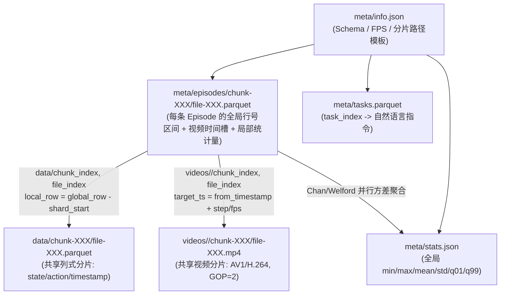

# LeRobot v3.0 底层架构与二进制机制深度研究

> 基于真实开源数据集 `lerobot/pusht`（v3.0，206 条轨迹，25,650 帧，96×96 AV1）以及本仓库 [lerobot_v3_deep.py](file:///D:/GitHub/EmbodiedAIDomainDataFormats/src/embodied_formats/lerobot_v3_deep.py) 的实测输出（运行 `uv run edlab lerobot-deep -n 100` 可一键复现）。

---

## 1. 整体架构：从 v2.1 到 v3.0 的存储范式演进

LeRobot v3.0 本质上是一个**面向具身智能的“列存 + 视频流 + 关系型元数据索引”三层解耦引擎**：



**为什么 v3.0 要放弃 v2.1 的“一轨迹一文件”？**
- v2.1 下，10 万条轨迹 × 3 路相机 = **40 万个文件**（10 万 Parquet + 30 万 MP4），在对象存储（S3/HF Hub）和分布式文件系统上会遭遇严重的元数据/Inode 瓶颈与高昂的打开关闭开销。
- v3.0 将多条轨迹**顺序拼接**到共享的 `file-XXX.parquet`（默认上限约 `100 MB`）和 `file-XXX.mp4`（默认上限约 `200 MB`），同时保证**单条 Episode 不会跨文件切碎**，把文件数压缩了 2–3 个数量级，并天然解锁免下载云端流式训练（`StreamingLeRobotDataset`）。

---

## 2. 控制面与 5 大数学不变式实测审计

对 `lerobot/pusht` 运行 `audit_v3_integrity()` 的实测结果：

| 不变式检查项 | 实测结果 | 工程意义 |
| --- | --- | --- |
| **全局行号连续性** | `info.json (25,650) == episodes.parquet 累计 (25,650)`，**0 空洞** | 保证 `dataset_from_index[i] == dataset_to_index[i-1]` |
| **Parquet 物理行数闭合** | `data/chunk-000/file-000.parquet` 实测 `25,650` 行 == 元数据汇总 `25,650` | 防止写入中断导致的残缺分片 |
| **视频时间槽 CFR 漂移** | `max_cfr_duration_drift_ms = 0.0 ms`，`>5ms` 断层数 = `0` | 确认严格 CFR，多轨迹拼接到同一 MP4 无累积漂移 |
| **MP4 物理帧数闭合** | `stsz` 实测 `25,650` 帧 == 元数据汇总 `25,650` | 防止编码器丢帧或缓冲未 flush |
| **Chan/Welford 统计量可重构性** | 用 206 条 Episode 局部 `(mean, std, count)` 聚合对比 `meta/stats.json`，`max_abs_mean_diff = 8.53e-14`，`max_abs_std_diff = 2.84e-14` | **float64 机器精度完全吻合**；证明多机并行写分片后无需重扫全量数据即可无损合并全局统计量 |

> **实测发现的坑点**：
> 1. `meta/tasks.parquet` 中，任务文本并不是存在名为 `task` 的普通列里，而是被 Pandas 写进了索引列 `__index_level_0__`；直接用 PyArrow 读时要兼容该列名。
> 2. `lerobot/pusht` 作为早期转制数据集，`meta/stats.json` 中 `has_q01_q99_in_global_stats = false`（仅含 `min/max/mean/std/count`），接入需要分位数截断的 VLA 训练管线前需注意补算 `q01/q99`。

---

## 3. Parquet 列式二进制底层解剖（`data/chunk-000/file-000.parquet`）

- **物理帧格式**：`[4B "PAR1"][RowGroup 0 .. RowGroup 25][27,537 B Thrift FileMetaData Footer][4B footer_len][4B "PAR1"]`
- **写入引擎**：`parquet-cpp-arrow version 19.0.1`
- **RowGroup 布局与 Predicate Pushdown**：
  - 25,650 行按每组 **1,000 行**切分为 **26 个 RowGroup**，每个 RowGroup 仅约 **31 KB**。
  - 首列 `observation.state.list.element` 的 `dictionary_page_offset = 4`（紧挨着文件头 `PAR1`），`data_page_offset = 8026`。
  - 每个 RowGroup 的 Thrift 元数据里自带各列 `Min/Max Statistics`：
    - `RG 0`：`episode_index ∈ [0, 7]`
    - `RG 1`：`episode_index ∈ [7, 14]`
    - `RG 5`：`episode_index ∈ [39, 47]`
  - 这意味着按 `episode_index` 查询时，Arrow/Parquet 引擎只需读文件末尾 `27.5 KB` 的 Footer，即可通过 **Predicate Pushdown** 直接跳过无关 RowGroup，实现微秒级定位。
- **全局行号 → 局部行号映射（v3.0 必踩坑）**：
  - `meta/episodes/*.parquet` 中的 `dataset_from_index` 是**跨分片全局行号**；打开具体某个 `data/chunk-c/file-f.parquet` 切片时，必须先减去该分片包含的最小 `dataset_from_index`：
    ```python
    local_row = (ep["dataset_from_index"] + step_index) - shard_start_global_row[(chunk_idx, file_idx)]
    ```

---

## 4. MP4 (ISO BMFF) `stbl` 精确字节寻址与随机 Seek 实测

### 4.1 顶层 Box 布局与云端流式读取影响

实测 `videos/observation.image/chunk-000/file-000.mp4`（6.57 MB）：

```text
Offset 0          : [ftyp]   32 B       (isom / av01 — AV1 编码)
Offset 32         : [free]    8 B
Offset 40         : [mdat]    6.42 MB   (全部 25,650 帧压缩视频载荷，实际字节从 48 开始)
Offset 6,735,984  : [moov]  151.35 KB   (索引元数据，位于文件尾部！is_faststart = False)
                      └── trak -> mdia -> minf -> stbl
                            ├── stts (24 B)       : Time-to-Sample (CFR 固定帧间隔)
                            ├── stss (50.33 KB)   : 12,880 个 Keyframe 索引 (avg_gop = 1.991)
                            ├── stsc (100 B)      : Sample-to-Chunk 映射
                            ├── stsz (100.21 KB)  : 25,650 帧各自的精确字节大小
                            └── stco (44 B)       : Chunk 在 mdat 中的 32-bit 物理偏移
```

- **系统工程洞察**：由于 `moov` 位于文件末尾（`6,735,984` 字节处，未开启 `-movflags +faststart`），在云端 HTTP Range 流式训练场景下，客户端必须先发起一次尾字节 Range 请求拉取 `moov`，拿到 `stbl` 表后才能按需 Range 拉取单个帧段。

### 4.2 从帧号到磁盘精确字节偏移的手工验证

用 [lerobot_v3_deep.py](file:///D:/GitHub/EmbodiedAIDomainDataFormats/src/embodied_formats/lerobot_v3_deep.py) 直接解析 `stsc + stco + stsz + stss` 算出的精确磁盘地址：

| 目标帧号 (0-based) | `mdat` 精确字节偏移 | 单帧压缩字节数 | 前置 Keyframe 帧号 | 需解码帧数 |
| ---: | ---: | ---: | ---: | ---: |
| `0` | `48`（紧跟 `mdat` 8B 头） | `410 B` | `0` | `1` |
| `165` | `40,134` | `392 B` | `165` | `1` |
| `25,649`（末帧） | `6,735,652` | `332 B` | `25,649` | `1` |

> 验证闭合：`6,735,652 + 332 = 6,735,984 == moov_offset`，1 字节不差！

### 4.3 PyAV 100 次随机 Seek vs 顺序解码实测

| 访问模式 | 吞吐 (fps) | P50 延迟 | P99 延迟 | 平均每次 Seek 解码帧数 | 最大解码帧数 |
| --- | ---: | ---: | ---: | ---: | ---: |
| **顺序解码（无 Seek）** | `6,857.4` | — | — | `1.00` | `1` |
| **跨轨迹随机 Seek** | `1,613.4` | `0.568 ms` | `2.678 ms` | **`1.83`** | **`3`** |

- 这组数据直观解释了 **`GOP = 2` 的价值**：在 25,650 帧的共享大 MP4 中任意随机跳帧，平均只需要解码 **1.83 帧** 就能命中目标画面；如果是普通视频默认的 `GOP = 250`，平均每次随机 Seek 都要白白解码 125 帧，吞吐会暴跌近 70 倍！

---

## 5. `delta_timestamps`（Action Chunking）与 `*_is_pad` 掩码机制

VLA / ACT / Diffusion Policy 训练时通常一次读取“过去 `obs_horizon` 帧观测 + 未来 `action_horizon` 步动作块”。以 Episode 1（全局行 `[161, 279)`，长度 118）末尾第 `115` 步为例：

- **观测查询** `delta_timestamps = [-0.1s, 0.0s]`：
  - 局部步号 `[114, 115]` → 全局 Parquet 行 `[275, 276]` → 视频时间槽 `[27.5s, 27.6s]` → `obs_is_pad = [False, False]`
- **动作块查询** `delta_timestamps = [0.0s, 0.1s, ..., 0.7s]`（`action_horizon = 8`）：
  - 原始步号：`[115, 116, 117, 118, 119, 120, 121, 122]`（后 5 步越过 Episode 边界！）
  - 截断步号：`[115, 116, 117, 117, 117, 117, 117, 117]`
  - 全局行号：`[276, 277, 278, 278, 278, 278, 278, 278]`
  - 掩码 `action_is_pad`：`[False, False, False, True, True, True, True, True]`
- **训练意义**：DataLoader 必须把 `action_is_pad` 一并送入 GPU，计算 Loss 时用 `~action_is_pad` 屏蔽越界填充步，防止策略在轨迹末尾学出错误的“原地重复动作”偏差。

---

## 6. 高清双摄真机实战：`lerobot/svla_so100_pickplace`（双 640×480 30FPS AV1 + RTX 5080 实测）

为验证真实机械臂高清多视角场景下的 LeRobot v3.0 底层特征与 I/O 瓶颈，我们对真实 SO-100 机械臂数据集 `lerobot/svla_so100_pickplace`（50 条轨迹、19,631 帧、30 FPS、双路 640×480 相机 `top` 305.54 MB + `wrist` 142.25 MB）执行了全套二进制解剖与性能压测（运行 `uv run edlab lerobot-hd -n 80` 复现）。

### 6.1 双摄二进制结构与 `pusht` 的关键差异

- **Parquet RowGroup 策略差异**：`svla_so100_pickplace` 由 `parquet-cpp-arrow 24.0.0` 写入，19,631 行打包为 **1 个 642 KB 的单 RowGroup**（对比 `pusht` 的 26 个 1,000 行 RowGroup）；说明不同版本/写入配置下 RowGroup 粒度并不固定。
- **双路视频严丝合缝的 CFR 与帧间压缩**：
  - `top` 与 `wrist` 均为 **19,631 帧**、**9,829 个 Keyframe**（`avg_gop = 1.997`）、`max_cfr_duration_drift_ms = 0.0003 ms`，均未开启 `faststart`（`moov` 位于 305 MB / 142 MB 尾部）。
  - 观察真实帧 `164 (I 帧)` 与 `165 (P 帧)` 的字节大小：
    - `top`：`I 帧 = 29,984 B` → `P 帧 = 542 B`（帧间压缩 **55x**）
    - `wrist`：`I 帧 = 16,672 B` → `P 帧 = 31 B`（帧间压缩 **538x**）

### 6.2 单步双摄随机采样延迟精确拆解（50 次随机采样均值）

| 环节 | 平均耗时 | P99 耗时 | 占单步总耗时比例 |
| --- | ---: | ---: | ---: |
| **Parquet 读取 `state` + `action`** | `0.151 ms` | — | **`3.38%`** |
| **`observation.images.top` (305.5 MB) Seek+解码** | `2.588 ms` | `3.174 ms` | **`57.95%`** |
| **`observation.images.wrist` (142.3 MB) Seek+解码** | `1.705 ms` | `3.207 ms` | **`38.18%`** |
| **双摄单步总计** | **`4.465 ms`** | **`5.927 ms`** | `100%` |

> **核心结论**：在高清双摄 LeRobot v3.0 训练中，**96.1% 的 DataLoader 耗时都在视频 Seek + 解码**；Parquet 查表几乎为零开销（3.4%）。

### 6.3 反直觉的系统实测：CPU (`libdav1d`) vs RTX 5080 NVDEC (`av1_cuvid`)

在 **NVIDIA GeForce RTX 5080 (16 GB)** 上实测 PyAV `libdav1d`（CPU 软解）与 `av1_cuvid`（NVDEC 硬解）：

| 相机 (640×480 AV1, GOP=2) | 解码器 | 顺序解码 FPS | 顺序 RGB 带宽 | 随机 Seek FPS | 随机 Seek P50 | 随机 Seek P99 |
| --- | --- | ---: | ---: | ---: | ---: | ---: |
| `observation.images.top` | **CPU (`libdav1d`)** | **2,173.4** | **1,910.3 MB/s** | **403.6** | **2.40 ms** | **3.25 ms** |
| `observation.images.top` | GPU (`av1_cuvid` via PyAV) | 1,225.3 | 1,076.9 MB/s | 39.3 | 23.47 ms | 74.88 ms |
| `observation.images.wrist` | **CPU (`libdav1d`)** | **2,116.1** | **1,859.8 MB/s** | **590.1** | **1.57 ms** | **3.62 ms** |
| `observation.images.wrist` | GPU (`av1_cuvid` via PyAV) | 1,258.5 | 1,106.1 MB/s | 38.1 | 24.55 ms | 46.22 ms |

**为什么 RTX 5080 NVDEC 在随机 Seek 下反而比 CPU 慢 10–15 倍？**
1. **硬件解码管线 Flush 代价极高**：每次随机 Seek 调用 `ctx.flush_buffers()` 都会排空 CUVID 硬件深流水线并重新同步初始化，单次延迟高达 ~23 ms；
2. **PCIe D2H 拷贝 + CPU 色彩转换**：PyAV 的 `av1_cuvid` 解码后需从显存拷回 Host 内存再经 CPU `swscale` 转 `NV12 → RGB24`（真正发挥 NVDEC 威力需要 **TorchCodec CUDA / NVIDIA DALI** 保持帧在 VRAM 内零拷贝直接转 RGB 喂给模型，且更适合高分辨率 1080p/4K 或长连续滑窗）；
3. **640×480 + `GOP=2` 恰好命中 `libdav1d` 甜点区**：单帧仅几十 KB、每次 Seek 仅解 `1.61` 帧，AVX 汇编软解完全吃满 CPU Cache，无任何硬件上下文同步开销。

### 6.4 多进程 DataLoader 扩展性实测（双摄 `obs=1, action_chunk=16`）

| Worker 进程数 | 稳态吞吐 (samples/s) | 有效 RGB 张量带宽 | 说明 |
| ---: | ---: | ---: | --- |
| `1` | `198.13` | `348.28 MB/s` | 单核即可跑满 ~200 双摄样本/秒 |
| `2` | `316.56` | `556.45 MB/s` | 1.60x 加速 |
| `4` | `456.89` | `803.14 MB/s` | 2.31x 加速 |
| **`8`** | **`560.17`** | **`984.67 MB/s`** | **接近 1 GB/s 有效 RGB 带宽，足以喂饱单卡 RTX 5080 的 VLA/ACT/DP 训练** |

---

## 7. VS Code 单步调试与 Hex Editor 字节对照指南

- **VS Code `F5` 启动项**：
  - `1. Deep Dive: LeRobot v3.0 (pusht)`（快速走通全套机制）
  - `1b. Deep Dive: LeRobot v3.0 HD Dual-Cam SO-100 (CPU vs RTX NVDEC)`（跟踪高清双摄瓶颈与 NVDEC）
- **推荐断点与 Watch 观察要点**：
  1. `src/embodied_formats/deep_dive/lerobot_v3.py` → `parse_mp4_sample_table()`
     - **Watch**：`btype`、`size`、`pos`、`keyframes_1based[:10]`、`sample_sizes[:10]`、`moov_offset`、`mdat_offset`
     - **观察重点**：亲眼看 `ftyp → free → mdat → moov` 顶层 Box 递归进入 `stbl`，体会 `moov` 位于文件末尾对云端 HTTP Range 流式读取的影响。
  2. `src/embodied_formats/deep_dive/lerobot_v3.py` → `MP4SampleTable.resolve_sample()`
     - **Watch**：`sample_idx_0based`、`kf_0based`、`offsets[sample_idx_0based]`、`decode_frames_needed`
     - **观察重点**：验证如何仅靠 `stss` 二分查找 + `stsc/stco/stsz` 算出任意帧的精确 `mdat` 磁盘偏移，以及 `GOP=2` 下仅需解码 1–2 帧。
  3. `src/embodied_formats/deep_dive/lerobot_v3.py` → `audit_v3_integrity()`（Chan/Welford 循环处）
     - **Watch**：`agg_mean`、`agg_m2`、`rec_std`、`ref_std`
     - **观察重点**：验证 206 条 Episode 局部统计量如何通过并行方差公式无损还原全局 `meta/stats.json`。
  4. `src/embodied_formats/formats/lerobot_v3_format.py` → `read_step()` / `read_window()`
     - **Watch**：`global_row`、`local_row`、`v_from`、`target_ts`
     - **观察重点**：牢记 v3.0 核心坑点——**全局行号必须减去分片起始行号才是 Parquet 局部索引**。
  5. `src/embodied_formats/deep_dive/lerobot_v3_hd.py` → `_benchmark_via_explicit_codec()`
     - **Watch**：`lat_ms`、`frames_per_seek`
     - **观察重点**：观察 `ctx.flush_buffers()` 在 RTX NVDEC 上触发的 ~23 ms 硬件管线排空尖峰。
- **Hex Editor 原始字节对照**：
  - `data/real/lerobot_v3_pusht/data/chunk-000/file-000.parquet`：开头 `0x00` 为 `50 41 52 31 (PAR1)`，末尾最后 8 字节为 4B `footer_len` + `PAR1`。
  - `data/real/lerobot_v3_pusht/videos/observation.image/chunk-000/file-000.mp4`：`0x00` 为 `ftyp isom av01`，跳转偏移 `6735984 (0x66C7B0)` 即为 `moov` 起始处。

---

## 8. 固定规范 vs 自定义扩展（字段级全拆解）

### 8.1 二进制容器与目录骨架（绝对固定 — 违背即无法解析）

| 位置 | 固定要素 | 具体含义与系统作用 |
| --- | --- | --- |
| **目录命名规范** | `meta/`、`data/chunk-{chunk_index:03d}/file-{file_index:03d}.parquet`、`videos/{video_key}/chunk-{chunk_index:03d}/file-{file_index:03d}.mp4` | 物理分片路径模板（默认每 1000 个 file 建一个 chunk 目录）；虽然模板字符串写在 `info.json` 里，但 `lerobot` 生态工具默认遵循此层级。 |
| **Parquet 物理结构** | Magic `PAR1`（首尾 4B）+ Thrift `FileMetaData` Footer + `footer_len(u32_le)` | Apache Parquet 标准列存格式；支持 RowGroup 级 `Min/Max` 统计实现 Predicate Pushdown。 |
| **MP4 / ISO BMFF** | `ftyp` + `mdat` + `moov -> trak -> mdia -> minf -> stbl (stts/stss/stsc/stsz/stco)` | 标准 MP4 容器；LeRobot 额外强制 **CFR 恒定帧率** 与 **极小 GOP（通常 `g=2, bf=0`）** 写入 `stss`，否则随机抽帧 CPU 会打满。 |

### 8.2 控制面元数据与必备系统列（框架固定 — v3.0 协议强制要求）

1. **`meta/info.json`**（全局 Schema 清单，固定核心键）：
   - `codebase_version`: 必须为 `"v3.0"`（区分 v2.1 的标志）。
   - `fps`: 全局统一帧率（如 `10` 或 `30`），所有视频与时间槽均以此为基准。
   - `total_episodes` / `total_frames` / `total_tasks`: 全局计数闭环校验基准。
   - `data_path` / `video_path`: 分片路径格式化模板。
   - `features`: 字典，声明每个特征的 `dtype`、`shape`、`names`；其中视频列固定包含 `info` 子字典（`video.fps`、`video.codec`、`video.pix_fmt`、`has_audio`）。
2. **`meta/episodes/chunk-XXX/file-XXX.parquet`**（v3.0 新增的核心关系型索引表，固定核心列）：
   - `episode_index` (`int64`)：全局轨迹编号。
   - `data/chunk_index`、`data/file_index` (`int64`)：该轨迹所在的 Parquet 分片坐标。
   - `dataset_from_index`、`dataset_to_index` (`int64`)：**跨分片全局行号**半开区间 `[from, to)`，长度 `length = to - from`。
   - `videos/{video_key}/chunk_index`、`file_index`、`from_timestamp`、`to_timestamp`：该轨迹在共享 MP4 中的精确时间槽（如 ep1 在 `[16.1s, 27.9s]`）。
   - `stats/{feature}/{min,max,mean,std,count}`：单条轨迹的局部统计量（用于并行分片后通过 Chan/Welford 无损合并）。
   - `tasks` (`list<string>`)：该轨迹对应的任务描述列表。
3. **`meta/tasks.parquet` & `meta/stats.json`**：
   - `tasks.parquet` 映射 `task_index (int64)` ↔ 任务文本（注意实测中文本常存储在 Pandas 索引列 `__index_level_0__`）；
   - `stats.json` 存储全数据集归一化参数（推荐包含 `q01`/`q99`，但早期转换集如 `lerobot/pusht` 仅含 `min`/`max`/`mean`/`std`/`count`）。
4. **`data/*.parquet` 必备 5 个系统列**（每帧一行，不可缺少）：
   - `episode_index` (`int64`)：所属轨迹 ID；
   - `frame_index` (`int64`)：轨迹内局部帧号（`0 .. length-1`）；
   - `timestamp` (`float32`)：轨迹内相对时间戳（`frame_index / fps`）；
   - `index` (`int64`)：全数据集全局行号（`0 .. total_frames-1`）；
   - `task_index` (`int64`)：关联 `meta/tasks.parquet` 的外键。

### 8.3 完全自定义与可配置层（随机器人/任务自由变化）

- **视觉特征名 (`dtype: "video"`)**：
  - 单视角可用 `observation.image`（如 `pusht` `96×96`），多视角通常按 `observation.images.<cam_name>` 命名（如 `svla_so100_pickplace` 自定义了 `observation.images.top` 和 `observation.images.wrist`，均为 `480×640×3`）。
  - 注意：`observation.images.*` 图像像素**不存储在 Parquet 中**，仅在 `info.json` 声明，实际数据按 `video_path` 存在 `.mp4` 里。
- **状态与动作向量 (`observation.state` / `action`)**：
  - 维度、物理量纲与 `names` 完全自定义：如 `pusht` 是 2 维平面坐标 `['motor_0', 'motor_1']`；SO-100 是 6 维关节角；双臂 ALOHA 则是 14 维。
- **RL / 扩展标记列**：
  - 如 `next.reward`、`next.done`、`next.success`（`pusht` 中存在，而真机遥操集 `svla_so100_pickplace` 中不存在）。
- **编码与分片超参**：
  - 编码器可选 `libsvtav1 (AV1)`、`h264`、`hevc`，`pix_fmt` 通常 `yuv420p`；单个 Parquet/MP4 分片大小上限（默认 ~100 MB / ~200 MB）可在采集/转换时自定义。

### 8.4 逐字段完整字典（基于真实样本 `lerobot/pusht` 与 `svla_so100_pickplace`）

#### A. `meta/info.json` 逐字段说明
| 字段名 | 类型 | 属性 | 具体含义 |
| --- | --- | --- | --- |
| `codebase_version` | `str` | 框架固定 | 数据集格式版本号，v3.0 固定为 `"v3.0"` |
| `robot_type` | `str` | 可自定义 | 机器人本体型号（如 `"so100"` / `"aloha"` / `"unknown"`） |
| `total_episodes` | `int` | 框架固定 | 全数据集总轨迹条数（`pusht=206`, `so100=50`） |
| `total_frames` | `int` | 框架固定 | 全数据集总时间步帧数（`pusht=25650`, `so100=19631`） |
| `total_tasks` | `int` | 框架固定 | 不同语言任务指令的总数 |
| `chunks_size` | `int` | 框架可配 | 每个 `chunk-XXX` 目录最多存放的分片文件数（默认 `1000`） |
| `data_files_size_in_mb` | `int` | 框架可配 | 单个 Parquet 分片体积上限（默认 `100` MB） |
| `video_files_size_in_mb` | `int` | 框架可配 | 单个 MP4 分片体积上限（默认 `200` MB） |
| `fps` | `int/float` | 框架固定 | 全局统一采样帧率（`pusht=10`, `so100=30`） |
| `splits` | `dict` | 可自定义 | 数据集划分区间（如 `{"train": "0:206"}`） |
| `data_path` | `str` | 框架固定 | Parquet 分片路径模板 |
| `video_path` | `str` | 框架固定 | MP4 分片路径模板 |
| `features` | `dict` | 半固定 | 所有列特征的 Schema 字典（含 `dtype`/`shape`/`names`/`info`） |

#### B. `data/chunk-XXX/file-XXX.parquet` 逐字段说明
| 字段名 | 类型 / Shape | 属性 | 具体含义 |
| --- | --- | --- | --- |
| `observation.state` | `float32[D]` | 约定+自定义 | 机器人本体状态向量（`pusht` 为 2 维平面位置；`so100` 为 6 维关节角） |
| `action` | `float32[A]` | 约定+自定义 | 执行动作/目标控制指令（`pusht` 为 2 维目标位置；`so100` 为 6 维目标关节角） |
| `episode_index` | `int64` | 框架固定 | 所属轨迹编号（`0 .. total_episodes-1`） |
| `frame_index` | `int64` | 框架固定 | 当前轨迹内的局部帧序号（`0 .. length-1`） |
| `timestamp` | `float32` | 框架固定 | 当前轨迹内的相对时间（秒，`frame_index / fps`） |
| `index` | `int64` | 框架固定 | 跨分片的全局行号（`0 .. total_frames-1`） |
| `task_index` | `int64` | 框架固定 | 关联 `meta/tasks.parquet` 的任务外键 ID |
| `next.reward` | `float32` | 可自定义 | 单步即时奖励（仅 RL/仿真集 `pusht` 有，真机集 `so100` 无） |
| `next.done` | `bool` | 可自定义 | 轨迹是否结束标志（仅 `pusht` 有） |
| `next.success` | `bool` | 可自定义 | 任务是否成功完成标志（仅 `pusht` 有） |

#### C. `meta/episodes/chunk-XXX/file-XXX.parquet` 逐字段说明
| 字段名 | 类型 | 属性 | 具体含义 |
| --- | --- | --- | --- |
| `episode_index` | `int64` | 框架固定 | 轨迹唯一 ID |
| `tasks` | `list[str]` | 框架固定 | 该轨迹对应的自然语言任务文本列表 |
| `length` | `int64` | 框架固定 | 该轨迹包含的总步数（`= dataset_to_index - dataset_from_index`） |
| `data/chunk_index` | `int64` | 框架固定 | 该轨迹所在的 `data/chunk-XXX` 目录编号 |
| `data/file_index` | `int64` | 框架固定 | 该轨迹所在的 `file-XXX.parquet` 文件编号 |
| `dataset_from_index` | `int64` | 框架固定 | 该轨迹在全局数据集中的起始行号（闭区间） |
| `dataset_to_index` | `int64` | 框架固定 | 该轨迹在全局数据集中的结束行号（开区间） |
| `videos/{cam}/chunk_index` | `int64` | 框架固定 | 该轨迹某路相机所在的 `videos/{cam}/chunk-XXX` 编号 |
| `videos/{cam}/file_index` | `int64` | 框架固定 | 该轨迹某路相机所在的 `file-XXX.mp4` 编号 |
| `videos/{cam}/from_timestamp` | `float64` | 框架固定 | 该轨迹在共享 MP4 中的起始时间戳（秒） |
| `videos/{cam}/to_timestamp` | `float64` | 框架固定 | 该轨迹在共享 MP4 中的结束时间戳（秒） |
| `stats/{feat}/{min,max,mean,std,count}` | `list/float` | 框架固定 | 该轨迹内各特征的局部统计量（用于并行合并 `meta/stats.json`） |
| `meta/episodes/chunk_index` & `file_index` | `int64` | 框架固定 | 本条索引记录自身所在的元数据分片位置 |

---

## 9. 参考资料与官方来源

- **LeRobot 官方仓库与 v3.0 数据集规范**：https://github.com/huggingface/lerobot （核心实现见 `src/lerobot/datasets/lerobot_dataset.py` 与 `v30/` 迁移工具）
- **Apache Parquet 二进制格式官方规范**：https://parquet.apache.org/docs/file-format/
- **ISO/IEC 14496-12 (ISO BMFF / MP4 容器 Box 规范)**：https://mpeg.chiariglione.org/standards/mpeg-4/iso-base-media-file-format
- **PyAV (FFmpeg Python 绑定) 官方文档**：https://pyav.basswood-io.com/docs/stable/
- **本实验实测开源数据集**：
  - `lerobot/pusht` (v3.0)：https://huggingface.co/datasets/lerobot/pusht
  - `lerobot/svla_so100_pickplace` (v3.0 双摄真机)：https://huggingface.co/datasets/lerobot/svla_so100_pickplace

