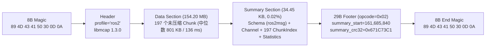

# ROS 2 bag / MCAP 底层架构与二进制机制深度研究

> 基于真实 RobotisAI 真机 ROS 2 录制样本 `evButtonPush-260608-0-MCAP`（episode 0：`0_0.mcap` 154.23 MB + `metadata.yaml` + `episode_info.json` + `robot.urdf`）以及本仓库 [mcap.py](../src/embodied_formats/deep_dive/mcap.py) 的实测输出（运行 `uv run edlab deep mcap` 或在 VS Code 中按 `F5` 选择 `5. Deep Dive: ROS 2 bag / MCAP` 可一键复现）。

---

## 1. 整体架构：Append-Only 二进制日志 + 尾部 Summary 索引 + Sidecar

- **文件系统**：单次录制 **4 个文件**（`0_0.mcap` 154.23 MB 占 `99.99%`，外部 3 个文本 Sidecar 共 `17.6 KB`）。
- **核心设计哲学**：面向真机低延迟顺序追加写入，保留纳秒级异构时间戳与完整 `ros2msg` Schema 定义（自描述，无需提前安装 ROS 2 消息包即可解析）；文件尾部仅 `34.45 KB` 的 Summary Section 让 Foxglove/Rerun 在毫秒内完成整包时间轴索引。

---

## 2. 197 个 ChunkIndex 与零 ROS 2 依赖的原始 CDR 二进制解码

- **Chunk 布局**：197 个 Chunk 均未做二次压缩（`compression = none`），因为 3 路相机内部已是 JPEG 压缩字节流，避免在机载端对不可压图像做无谓的 Zstd CPU 消耗；Chunk 大小 `55.4 KB – 850.9 KB`（中位数 `801.4 KB`），时间跨度 `9.4 ms – 193.8 ms`（中位数 `136.5 ms`）。
- **手写 `CDRReader` 直接解码 ROS 2 CDR 小端线协议**（前 4 字节封装头实测为 `00 01 00 00` = `CDR_LE`，按 4/8 字节自然对齐）：
  - **3 路相机（`sensor_msgs/msg/CompressedImage`）**：
    - `/camera/cam_top/color/image_raw/compressed`：`640×480 RGB`，内嵌 JPEG `FF D8 FF E0`（`55.8 KB`）
    - `/camera/cam_belly/color/image_raw/compressed`：`640×480 RGB`，内嵌 JPEG `FF D8 FF E0`（`52.5 KB`）
    - `/camera/cam_wrist/color/image_rect_raw/compressed`：`640×480 RGB`，内嵌 JPEG `FF D8 FF E0`（`77.4 KB`）
    - **真实工程坑点线索**：3 路相机的 `format` 字段均为 `"rgb8; jpeg compressed bgr8"`，离线转训练数据时必须明确核对 BGR/RGB 通道顺序！
  - **双路关节状态（`sensor_msgs/msg/JointState`）**：
    - `/leader/joint_states`（遥操主手 7 维）：`joint1..joint6 + rh_r1_joint`，精确解出 `float64` 弧度、速度、力矩；
    - `/joint_states`（整机 16 维）：4 轮转向/驱动（8 维）+ 颈/头（2 维）+ `omy_joint1..6`（6 维）。

---

## 3. 真机多传感器异步时钟抖动与跨通道对齐偏差实测（27.16 秒录制）

| Topic | 消息数 | 有效频率 | 帧间隔 `dt`（均值 ± 标准差） | 最大帧间隔（掉帧尖峰） | 对齐主相机 `cam_top` 偏差（均值 / P95 / 最大） |
| --- | ---: | ---: | ---: | ---: | ---: |
| `/camera/cam_top/...`（主时钟） | `775` | `28.51 Hz` | `35.07 ± 15.59 ms` | **`123.39 ms`** | 基准 (`0 ms`) |
| `/camera/cam_belly/...` | `763` | `28.08 Hz` | `35.62 ± 17.57 ms` | **`147.42 ms`** | `11.61 / 32.82 / 70.07 ms` |
| `/camera/cam_wrist/...` | `814` | `30.00 Hz` | `33.34 ± 8.77 ms` | `95.76 ms` | `9.82 / 17.47 / 42.03 ms` |
| `/joint_states` | `5,250` | **`193.37 Hz`** | `5.17 ± 1.76 ms` | `32.91 ms` | `1.33 / 2.91 / 13.40 ms` |
| `/leader/joint_states` | `5,267` | **`194.00 Hz`** | `5.16 ± 1.62 ms` | `18.68 ms` | `1.48 / 2.89 / 11.76 ms` |
| `/tf` | `1,055` | `38.84 Hz` | `25.74 ± 14.89 ms` | `53.57 ms` | `8.94 / 21.27 / 25.01 ms` |

> **核心工程启示**：真实机器人上的 3 路相机不仅存在严重抖动与掉帧（最大间隔 `147.4 ms`，相当于连续丢 4 帧），彼此间也存在 `10–70 ms` 的异步相位差；这从第一性原理印证了工业界 **“MCAP 真机采集回放 → 离线主相机 CFR 对齐清洗 → LeRobot v3.0 / Zarr 训练”** 两段式流水线的必然性。

---

## 4. Sidecar 非二进制元数据组织关系

- **`metadata.yaml`（1.95 KB）**：ROS 2 `rosbag2_bagfile_information` v9，记录总时长 `27.159 s`、总消息数 `13,924`、6 个 Topic 的类型与 QoS。
- **`episode_info.json`（265 B）**：业务侧 Episode 标签（`"task_instruction": "push the elevator call button"`、`robot_type: "frontier_omy_f3m"`、`device_serial: "gaemi-1-g50-0203"`、`fps: 15`）。
- **`robot.urdf`（15.41 KB XML）**：完整运动学连杆/关节树（`robot name="omy_f3m"`，`17` 个 `<link>`、`16` 个 `<joint>` = `6 fixed + 10 revolute`），与 `/joint_states`、`/tf` 联合还原 3D 机器人姿态。

---

## 5. 调试入口与推荐断点

- **CLI**：`uv run edlab deep mcap`
- **VS Code `F5`**：`5. Deep Dive: ROS 2 bag / MCAP (Chunks + Raw CDR Decode + Clock Skew)`
- **推荐断点**：
  - `src/embodied_formats/deep_dive/mcap.py`：`CDRReader`、`decode_ros2_compressed_image_cdr()`、`decode_ros2_joint_state_cdr()`、`analyze_async_clocks_and_alignment()`
  - `src/embodied_formats/formats/mcap_format.py`：`read_step()`
