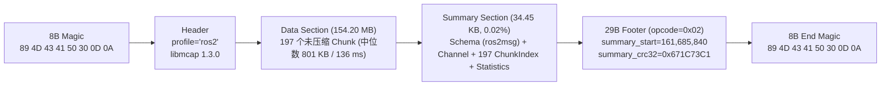

# ROS 2 bag / MCAP 底层架构与二进制机制深度研究

> 基于真实 RobotisAI 真机 ROS 2 录制样本 `evButtonPush-260608-0-MCAP`（episode 0：`0_0.mcap` 154.23 MB + `metadata.yaml` + `episode_info.json` + `robot.urdf`）以及本仓库 [mcap.py](../src/embodied_formats/deep_dive/mcap.py) 的实测输出（运行 `uv run edlab deep mcap` 或在 VS Code 中按 `F5` 选择 `5. Deep Dive: ROS 2 bag / MCAP` 可一键复现）。

---

## 1. 整体架构：Append-Only 二进制日志 + 尾部 Summary 索引 + Sidecar

- **文件系统**：单次录制 **4 个文件**（`0_0.mcap` 154.23 MB 占 `99.99%`，外部 3 个文本 Sidecar 共 `17.6 KB`）。
- **核心设计哲学**：面向真机低延迟顺序追加写入，保留纳秒级异构时间戳与完整 `ros2msg` Schema 定义（自描述，无需提前安装 ROS 2 消息包即可解析）；文件尾部仅 `34.45 KB` 的 Summary Section 让 Foxglove/Rerun 在毫秒内完成整包时间轴索引。

---

## 2. 197 个 ChunkIndex 与零 ROS 2 依赖的原始 CDR 二进制解码

- **Chunk 布局**：197 个 Chunk 均未做二次压缩（`compression = none`），因为 3 路相机内部已是 JPEG 压缩字节流，避免在机载端对不可压图像做无谓的 Zstd CPU 消耗；Chunk 大小 `55.4 KB – 850.9 KB`（中位数 `801.4 KB`），时间跨度 `9.4 ms – 193.8 ms`（中位数 `136.5 ms`）。
- **手写 `CDRReader` 直接解码 ROS 2 CDR 小端线协议**（前 4 字节封装头实测为 `00 01 00 00` = `CDR_LE`，按 4/8 字节自然对齐）：
  - **3 路相机（`sensor_msgs/msg/CompressedImage`）**：
    - `/camera/cam_top/color/image_raw/compressed`：`640×480 RGB`，内嵌 JPEG `FF D8 FF E0`（`55.8 KB`）
    - `/camera/cam_belly/color/image_raw/compressed`：`640×480 RGB`，内嵌 JPEG `FF D8 FF E0`（`52.5 KB`）
    - `/camera/cam_wrist/color/image_rect_raw/compressed`：`640×480 RGB`，内嵌 JPEG `FF D8 FF E0`（`77.4 KB`）
    - **真实工程坑点线索**：3 路相机的 `format` 字段均为 `"rgb8; jpeg compressed bgr8"`，离线转训练数据时必须明确核对 BGR/RGB 通道顺序！
  - **双路关节状态（`sensor_msgs/msg/JointState`）**：
    - `/leader/joint_states`（遥操主手 7 维）：`joint1..joint6 + rh_r1_joint`，精确解出 `float64` 弧度、速度、力矩；
    - `/joint_states`（整机 16 维）：4 轮转向/驱动（8 维）+ 颈/头（2 维）+ `omy_joint1..6`（6 维）。

---

## 3. 真机多传感器异步时钟抖动与跨通道对齐偏差实测（27.16 秒录制）

| Topic | 消息数 | 有效频率 | 帧间隔 `dt`（均值 ± 标准差） | 最大帧间隔（掉帧尖峰） | 对齐主相机 `cam_top` 偏差（均值 / P95 / 最大） |
| --- | ---: | ---: | ---: | ---: | ---: |
| `/camera/cam_top/...`（主时钟） | `775` | `28.51 Hz` | `35.07 ± 15.59 ms` | **`123.39 ms`** | 基准 (`0 ms`) |
| `/camera/cam_belly/...` | `763` | `28.08 Hz` | `35.62 ± 17.57 ms` | **`147.42 ms`** | `11.61 / 32.82 / 70.07 ms` |
| `/camera/cam_wrist/...` | `814` | `30.00 Hz` | `33.34 ± 8.77 ms` | `95.76 ms` | `9.82 / 17.47 / 42.03 ms` |
| `/joint_states` | `5,250` | **`193.37 Hz`** | `5.17 ± 1.76 ms` | `32.91 ms` | `1.33 / 2.91 / 13.40 ms` |
| `/leader/joint_states` | `5,267` | **`194.00 Hz`** | `5.16 ± 1.62 ms` | `18.68 ms` | `1.48 / 2.89 / 11.76 ms` |
| `/tf` | `1,055` | `38.84 Hz` | `25.74 ± 14.89 ms` | `53.57 ms` | `8.94 / 21.27 / 25.01 ms` |

> **核心工程启示**：真实机器人上的 3 路相机不仅存在严重抖动与掉帧（最大间隔 `147.4 ms`，相当于连续丢 4 帧），彼此间也存在 `10–70 ms` 的异步相位差；这从第一性原理印证了工业界 **“MCAP 真机采集回放 → 离线主相机 CFR 对齐清洗 → LeRobot v3.0 / Zarr 训练”** 两段式流水线的必然性。

---

## 4. Sidecar 非二进制元数据组织关系

- **`metadata.yaml`（1.95 KB）**：ROS 2 `rosbag2_bagfile_information` v9，记录总时长 `27.159 s`、总消息数 `13,924`、6 个 Topic 的类型与 QoS。
- **`episode_info.json`（265 B）**：业务侧 Episode 标签（`"task_instruction": "push the elevator call button"`、`robot_type: "frontier_omy_f3m"`、`device_serial: "gaemi-1-g50-0203"`、`fps: 15`）。
- **`robot.urdf`（15.41 KB XML）**：完整运动学连杆/关节树（`robot name="omy_f3m"`，`17` 个 `<link>`、`16` 个 `<joint>` = `6 fixed + 10 revolute`），与 `/joint_states`、`/tf` 联合还原 3D 机器人姿态。

---

## 5. VS Code 单步调试与 Hex Editor 字节对照指南

- **CLI**：`uv run edlab deep mcap`
- **VS Code `F5` 启动项**：`5. Deep Dive: ROS 2 bag / MCAP (Chunks + Raw CDR Decode + Clock Skew)`
- **推荐断点与 Watch 观察要点**：
  1. `src/embodied_formats/deep_dive/mcap.py` → `CDRReader`、`decode_ros2_compressed_image_cdr()`、`decode_ros2_joint_state_cdr()`
     - **Watch**：`data[:16]`、`self.pos`（观察 `_align(4)` 与 `_align(8)` 的内存对齐步进）、`fmt` (`"rgb8; jpeg compressed bgr8"`)、`names`、`positions`
     - **观察重点**：零 ROS 2 安装手解 OMG CDR 二进制协议，直接看懂 DDS 序列化内存布局。
  2. `src/embodied_formats/deep_dive/mcap.py` → `analyze_async_clocks_and_alignment()`
     - **Watch**：`dts_ms`、`per_topic_jitter`、`best_ms`、`alignment_skew`
     - **观察重点**：亲眼看到真机三路相机 `147 ms` 掉帧尖峰、彼此 `10–70 ms` 相位差，以及 193 Hz 关节与 29 Hz 相机的最近邻对齐偏差。
  3. `src/embodied_formats/deep_dive/mcap.py` → `analyze_mcap_sidecars()`
     - **Watch**：`bag_info`、`out["robot_urdf"]`
     - **观察重点**：看 `metadata.yaml` + `episode_info.json` + `robot.urdf` 如何与 `.mcap` 配合构成完整真机回放上下文。
- **Hex Editor 原始字节对照**：
  - 打开 `data/real/mcap_robotis_button_push/0_0.mcap`：
    - 文件首 8 字节与尾 8 字节均为 `89 4D 43 41 50 30 0D 0A`（`\x89MCAP0\r\n`）；
    - 倒数 37 字节处是 `02`（Footer Opcode），紧跟 `summary_start = 161,685,840`。

---

## 6. 固定规范 vs 自定义扩展（字段级全拆解）

### 6.1 MCAP 二进制容器层（绝对固定 — MCAP v0 规范定义）

| 位置 | 固定要素 | 具体含义与系统作用 |
| --- | --- | --- |
| **首尾 Magic** | `89 4D 43 41 50 30 0D 0A` (`\x89MCAP0\r\n`) | 位于文件最前 8B 与最后 8B，快速校验文件是否完整写入未截断。 |
| **Record 帧格式** | `[1B opcode][uint64_le record_len][record_body]` | 所有内容均以 Record 封装：`Header(0x01)`、`Footer(0x02)`、`Schema(0x03)`、`Channel(0x04)`、`Message(0x05)`、`Chunk(0x06)`、`ChunkIndex(0x08)`、`Statistics(0x0B)`。 |
| **Message 固定头** | `channel_id(u16)` + `sequence(u32)` + `log_time(u64_ns)` + `publish_time(u64_ns)` + `data` | 每条传感器消息都强制携带纳秒级 `log_time`（落盘时间）与 `publish_time`（采集时间）。 |
| **Footer 与 Summary** | 倒数 37 字节处 `0x02` Footer 指向 `summary_start` 与 `summary_crc32` | 让 Foxglove / Rerun / `mcap` SDK 无需扫描整个大文件即可一次性拿到全部 Schema、Channel 与 ChunkIndex。 |

### 6.2 ROS 2 生态约定层（`profile="ros2"` 下的半固定规范）

MCAP 本身语言与序列化无关（也可存 Protobuf / JSON / FlatBuffers），但在 ROS 2 `rosbag2` 生态下存在固定约定：
- **封装头与对齐**：`message_encoding = "cdr"`，每条消息前 4 字节固定为封装头（`00 01 00 00` 表示 `CDR_LE` 小端），内部字段严格遵循 OMG CDR 4/8 字节自然对齐；
- **自描述 Schema**：`schema_encoding = "ros2msg"`，文件内嵌完整 `.msg` 文本定义（如 `sensor_msgs/msg/CompressedImage`、`sensor_msgs/msg/JointState`、`tf2_msgs/msg/TFMessage`），使解析端无需安装 ROS 2 即可还原结构体；
- **`metadata.yaml`**：`rosbag2` 录制目录标准伴生文件，固定记录 `version`、`storage_identifier: mcap`、`duration.nanoseconds`、`starting_time`、`message_count` 及各 Topic QoS。

### 6.3 完全自定义层（随硬件平台、采集架构与团队自由定制）

- **Topic 拓扑、命名与硬件频率**：
  - 相机路数与 Topic 名完全由机器人配置决定（本样本为 `/camera/cam_top/...`、`/camera/cam_belly/...`、`/camera/cam_wrist/...`）；
  - 遥操与本体状态 Topic 命名与关节自由度完全自定义（本样本 `/leader/joint_states` 7 维 vs `/joint_states` 16 维含底盘轮子+机械臂）；
  - 是否单独录制 `/teleop/action_cmd` 控制指令 Topic（用于区分观测状态与目标指令）。
- **传感器图像压缩与编码策略**：
  - 既可以发未压缩 `sensor_msgs/msg/Image`（`rgb8`/`bgr8`）再开启 MCAP Chunk 级 `zstd` 压缩，也可以像本样本一样直接发 `CompressedImage`（JPEG）并关闭 Chunk 压缩（`compression = none`）以节省机载 CPU。
- **MCAP Metadata / Attachment 与外部 Sidecar 文件**：
  - MCAP 容器内部允许写入任意自定义 `Metadata` / `Attachment` Record；
  - 外部目录中的 **`episode_info.json`**（如 `"task_instruction"`、`"device_serial"`、`"needs_review"`）和 **`robot.urdf`**（`omy_f3m` 运动学连杆/关节 XML）完全属于机器人厂商与采集团队的自定义工程扩展。

### 6.4 逐字段完整字典（基于真实样本 `RobotisAI evButtonPush 0_0.mcap`）

#### A. MCAP 二进制内部 Record 与 ROS 2 CDR 固定消息字段
| 位置 / 消息类型 | 字段名 | 类型 | 属性 | 具体含义 |
| --- | --- | --- | --- | --- |
| **MCAP Message 头** | `channel_id` | `uint16` | 规范固定 | 关联 Summary 中的 Topic 通道 ID |
| **MCAP Message 头** | `sequence` | `uint32` | 规范固定 | 通道内消息序号 |
| **MCAP Message 头** | `log_time` | `uint64` (ns) | 规范固定 | 录制器接收到消息并写入磁盘的纳秒时间戳 |
| **MCAP Message 头** | `publish_time` | `uint64` (ns) | 规范固定 | 发布端时间戳（纳秒） |
| **ROS 2 `std_msgs/Header`** | `stamp.sec` & `nanosec` | `int32` + `uint32` | 生态固定 | 传感器硬件/节点内嵌的采集时间戳 |
| **ROS 2 `std_msgs/Header`** | `frame_id` | `string` | 生态固定 | 该数据所属的 TF 坐标系名称（如 `"cam_top_color_optical_frame"`） |
| **`CompressedImage`** | `format` | `string` | 生态固定 | 压缩编码说明（本样本为 `"rgb8; jpeg compressed bgr8"`） |
| **`CompressedImage`** | `data` | `uint8[]` | 生态固定 | 原始 JPEG/PNG 压缩字节流（`FF D8 FF E0`） |
| **`JointState`** | `name` | `string[]` | 生态固定 | 关节名称列表（如 `omy_joint1..6`） |
| **`JointState`** | `position` / `velocity` / `effort` | `float64[]` | 生态固定 | 关节角度(rad)/线位移(m)、角速度(rad/s)、力矩(Nm) |

#### B. 录制 Topic 通道与外部 Sidecar 逐字段说明
| 文件 / Topic 路径 | Schema / 类型 | 属性 | 具体含义 |
| --- | --- | --- | --- |
| `/camera/cam_top/color/image_raw/compressed` | `CompressedImage` (28.5 Hz) | 自定义 | 顶部主视角 640×480 JPEG 图像流 |
| `/camera/cam_belly/color/image_raw/compressed` | `CompressedImage` (28.1 Hz) | 自定义 | 机身腹部视角 640×480 JPEG 图像流 |
| `/camera/cam_wrist/color/image_rect_raw/compressed` | `CompressedImage` (30.0 Hz) | 自定义 | 腕部去畸变视角 640×480 JPEG 图像流 |
| `/joint_states` | `JointState` (193.4 Hz, 16 维) | 自定义 | 整机全关节状态（4 轮转向/驱动 8 维 + 颈/头 2 维 + `omy_joint1..6` 6 维） |
| `/leader/joint_states` | `JointState` (194.0 Hz, 7 维) | 自定义 | 遥操作主手关节状态（`joint1..6` + `rh_r1_joint` 夹爪） |
| `/tf` | `tf2_msgs/TFMessage` (38.8 Hz) | 生态约定 | 机器人各连杆坐标系之间的实时 3D 刚体变换树 |
| `metadata.yaml` | `rosbag2_bagfile_information` (v9) | 生态固定 | `duration.nanoseconds`、`starting_time`、`message_count`、`topics_with_message_count` |
| `episode_info.json` → `task_instruction` | `str` | 自定义 | 任务自然语言指令（`"push the elevator call button"`） |
| `episode_info.json` → `robot_type` & `device_serial` | `str` | 自定义 | 机器人型号（`"frontier_omy_f3m"`）与设备序列号（`"gaemi-1-g50-0203"`） |
| `episode_info.json` → `episode_index` / `fps` / `needs_review` | `int/bool` | 自定义 | 轨迹编号、目标抽帧帧率（`15`）、人工质检标记 |
| `robot.urdf` | XML (`<link>`/`<joint>`) | 自定义 | 17 个连杆与 16 个关节的物理尺寸、限位与运动学树 |
