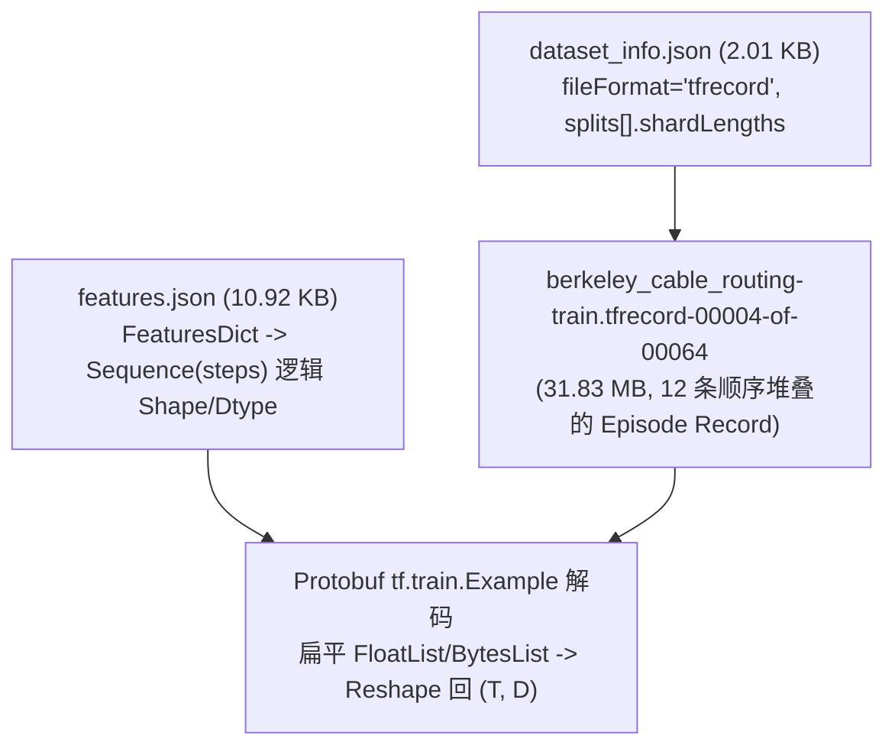

# RLDS / TFRecord 底层架构与二进制机制深度研究

> 基于真实 Open X-Embodiment 官方开源样本 `berkeley_cable_routing`（`dataset_info.json` + `features.json` + `berkeley_cable_routing-train.tfrecord-00004-of-00064`，31.83 MB）以及本仓库 [rlds.py](../src/embodied_formats/deep_dive/rlds.py) 的实测输出（运行 `uv run edlab deep rlds -n 25` 或在 VS Code 中按 `F5` 选择 `2. Deep Dive: RLDS / TFRecord` 可一键复现）。

---

## 1. 整体架构与文件组织关系



- **文件系统**：极简分片模式（单分片仅 **3 个文件**：`dataset_info.json` + `features.json` + `.tfrecord-00004-of-00064`），无小文件爆炸问题。
- **核心设计哲学**：将**一整条 Episode**打包为单个 `tf.train.Example` Protobuf 记录，顺序追加写入 TFRecord 分片；天然适合大规模分布式预训练集群（如 OXE / OpenVLA / Octo）的顺序流式扫描。

---

## 2. 二进制帧格式与全分片 Castagnoli Masked CRC32C 审计

TFRecord 单条记录的精确物理帧布局（零 TensorFlow 依赖，见 [rlds_format.py](../src/embodied_formats/formats/rlds_format.py)）：

```text
[0..7]             uint64_le length
[8..11]            uint32_le masked_crc32c(length_bytes)
[12..12+length-1]  bytes     serialized tf.train.Example protobuf
[12+length..+3]    uint32_le masked_crc32c(payload)
```
其中 `masked_crc32c(x) = (((crc32c(x) >> 15) | (crc32c(x) << 17)) + 0xA282EAD8) & 0xFFFFFFFF`。

**对 `berkeley_cable_routing-train.tfrecord-00004-of-00064` 全分片实测**：
- 分片内共 **12 条 Episode 记录**，与 `dataset_info.json` 中 `splits[train].shardLengths[4] == 12` **100% 精确闭合**。
- **12/12 条记录**的 `length_masked_crc32c` 与 `payload_masked_crc32c` 均校验通过。
- 单条 Episode 体积：`min = 1.57 MB`、`median = 2.41 MB`、`max = 5.62 MB`：
  - Record 0：偏移 `0`，载荷偏移 `12`，载荷 `2,154,633 B` (`2.05 MB`)
  - Record 1：紧接偏移 `2,154,649`（`= 12 + 2,154,633 + 4`），载荷 `3,080,404 B` (`2.94 MB`)
  - Record 2：偏移 `5,235,069`，载荷 `2,459,357 B` (`2.35 MB`)
  - Record 3：偏移 `7,694,442`，载荷 `5,894,865 B` (`5.62 MB`)

---

## 3. Episode 0 Protobuf Wire 载荷拆解与 `features.json` 重塑

对 Episode 0（18 步，`2.05 MB`）做 Protobuf 字段级字节审计：

| 载荷类别 | 占整条 Record 比例 | 实测底层细节 |
| --- | ---: | --- |
| **4 路相机图像** | **`98.19%`** | 手解 PNG IHDR 头确认全部为 **128×128 8-bit RGB 无损 PNG**（`image` / `top_image` / `wrist225_image` / `wrist45_image`，单帧 `24–32 KB`） |
| **预计算语言 Embedding** | **`1.71%`** | `steps/observation/natural_language_embedding`：`9,216` 个 float32（`36 KB`），经 `features.json` 重塑为 `(18, 512)` |
| **状态与动作** | **`0.05%`** | `robot_state` `(18, 7)` + `world_vector` `(18, 3)` + `rotation_delta` `(18, 3)` |
| **标量与文本控制位** | **`0.03%`** | `is_first` / `is_last` / `is_terminal` / `reward` / `natural_language_instruction` |

> **关键机制**：TFRecord 内部的 Protobuf `Example` 只存扁平一维 `FloatList/BytesList`，**没有维度信息**；必须联合 `features.json` 的 `FeaturesDict -> Sequence(steps)` Schema 才能还原多维 Tensor。

---

## 4. 随机读取退化实测：为何必须依赖 Shuffle Buffer

| 访问模式（`steps/observation/top_image`） | 读放大倍数 | 吞吐 (samples/s) | P50 延迟 | P99 延迟 |
| --- | ---: | ---: | ---: | ---: |
| **无缓存跨轨迹随机抽 1 帧**（读整条 2–5 MB Episode + 全量 Protobuf 反序列化） | **`89.1x`** | `348.7` | `2.23 ms` | **`10.24 ms`** |
| **内存 Episode / Shuffle Buffer**（顺序流式预读后在 RAM 内打乱） | `1.0x` | **`2,929.6`** | `0.34 ms` | **`0.36 ms`** |

- **系统结论**：TFRecord 无内置随机索引 + RLDS 整轨打包，导致磁盘级随机单帧读取存在 **89.1x 读放大**（吞吐暴跌 **8.4 倍**）。因此 TFDS / `dlimp` / OpenVLA 训练管线必须顺序流式读分片 + 在内存中维护大型 `shuffle_buffer`（或升级到支持随机偏移索引的 `ArrayRecord` / `LeRobot v3.0`）。

---

## 5. VS Code 单步调试与 Hex Editor 字节对照指南

- **CLI**：`uv run edlab deep rlds -n 25`
- **VS Code `F5` 启动项**：`2. Deep Dive: RLDS / TFRecord (CRC32C + Protobuf + Read-Amp)`
- **推荐断点与 Watch 观察要点**：
  1. `src/embodied_formats/deep_dive/rlds.py` → `audit_tfrecord_shard()`
     - **Watch**：`rec_start`、`length`、`hex(len_crc)`、`len_crc_ok`、`payload_crc_ok`
     - **观察重点**：体会 TFRecord 没有任何目录/索引，必须逐条按 `12 + length + 4` 顺序跳帧扫描。
  2. `src/embodied_formats/formats/rlds_format.py` → `decode_tf_example()` 与 `_iter_pb_fields()`
     - **Watch**：`tag`、`field_num`、`wire_type`、`key`、`features_dict.keys()`
     - **观察重点**：零 TensorFlow 依赖手解 Protobuf 线协议（varint + length-delimited + packed float32），观察为何扁平 `9216` 个 float 必须靠 `features.json` 才能 reshape 成 `(18, 512)`。
  3. `src/embodied_formats/deep_dive/rlds.py` → `profile_random_read_degradation()`
     - **Watch**：`bytes_read_total / bytes_useful_total`（`89.1x` 读放大）、`nocache_ms` vs `cached_ms`
     - **观察重点**：直观感受“为取 1 帧 32 KB PNG 却要反序列化整条 2–5 MB Episode Protobuf”的真实代价。
- **Hex Editor 原始字节对照**：
  - 打开 `data/real/rlds_berkeley_cable_routing/berkeley_cable_routing-train.tfrecord-00004-of-00064`：
    - `0x00..0x07`：`89 E0 20 00 00 00 00 00`（小端 `uint64` = `2,154,633`）
    - `0x08..0x0B`：`89 F3 DD 25`（小端 Masked CRC32C = `0x25DDF389`）
    - `0x17..`：可见明文 ASCII `steps/observation/...`，往后翻可见无损 PNG 魔数 `89 50 4E 47 0D 0A 1A 0A`。

---

## 6. 固定规范 vs 自定义扩展（Fixed vs Custom）

| 层级 | 固定 / 自定义 | 具体内容与含义 |
| --- | --- | --- |
| **TFRecord 二进制帧** | **完全固定** | `[uint64_le len][uint32_le masked_crc32c(len)][payload][uint32_le masked_crc32c(payload)]`，以及 `tf.train.Example` 的 Protobuf Wire 结构（`BytesList` / `FloatList` / `Int64List`）。 |
| **TFDS 控制面文件** | **框架固定** | `dataset_info.json`（声明 `fileFormat`、`splits[].shardLengths`）与 `features.json`（声明逻辑 Tensor 维度、dtype、图像编码）。 |
| **RLDS 顶层轨迹骨架** | **生态固定** | 每条 Record 代表 1 条完整 Episode，内部必须有 `steps/` 序列，且包含 `steps/is_first`、`steps/is_last`、`steps/is_terminal`、`steps/reward`（标准 RL 步进标记）。 |
| **`observation` 与 `action` 子树** | **完全自定义** | 相机数量与命名（如 `berkeley_cable_routing` 自定义了 `image` / `top_image` / `wrist225_image` / `wrist45_image`）、图像编码（PNG 或 JPEG）、状态/动作字段拆分（如 `world_vector` + `rotation_delta` + `terminate_episode`）、是否预存 `natural_language_embedding`。 |
