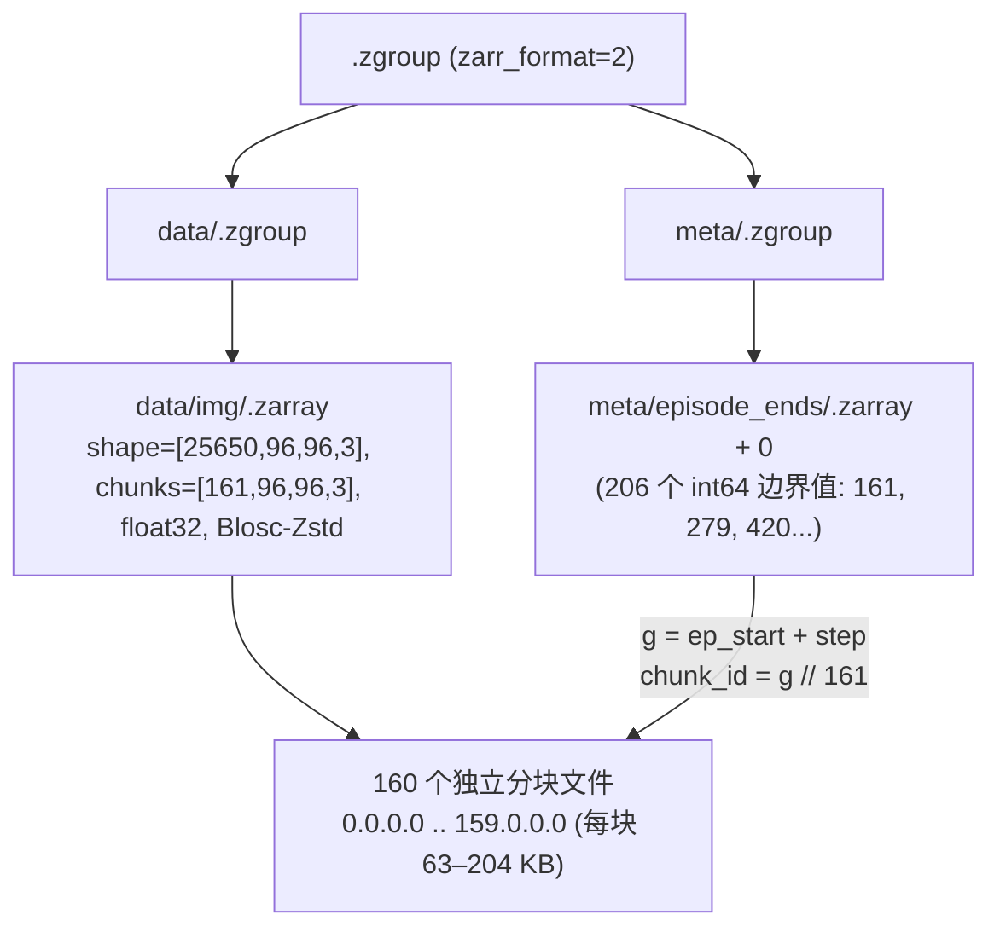

# Zarr / Diffusion Policy 底层架构与二进制机制深度研究

> 基于真实 Columbia Diffusion Policy 官方开源样本 `pusht_cchi_v7_replay.zarr`（与 `lerobot/pusht` 同源：206 条轨迹、25,650 帧、819 个文件、29.57 MB）以及本仓库 [zarr.py](../src/embodied_formats/deep_dive/zarr.py) 的实测输出（运行 `uv run edlab deep zarr -n 60` 或在 VS Code 中按 `F5` 选择 `4. Deep Dive: Zarr / Diffusion Policy` 可一键复现）。

---

## 1. 整体架构：目录树分块数组 + 扁平零拷贝轨迹索引



- **文件系统特征**：同样 25,650 帧，Zarr 展开为 **819 个文件（660 个 `<64 KB`，小文件占比 `80.6%`）**，总计 `29.57 MB`（对比同源 LeRobot v3.0 仅 `15` 个文件、`7.33 MB`）。
- **核心设计哲学**：每个 N 维 Chunk 都是独立的磁盘文件（或 S3/OSS 对象），彻底消除 HDF5 单文件全局锁，天然支持无锁多进程高并发读取；所有轨迹首尾拼接为扁平全局数组，仅靠 `meta/episode_ends` 做虚拟切分。

---

## 2. 全量 160 个 Blosc Chunk 二进制头扫描

每个 Chunk 文件前 **16 字节**是标准 Blosc 二进制头（`<BBBBIII`），如 `data/img/0.0.0.0`：
```text
02 01 94 04 | 00 B0 0F 01 | 00 00 04 00 | 4D AB 02 00
ver=2 lz=1 flags=0x94 typesize=4 | nbytes=17,805,312 (16.98 MB) | blocksize=262,144 | cbytes=174,925 (170.83 KB)
```

**全量扫描 `data/img` 全部 160 个分块的实测结果**：
- **数据类型细节**：图像竟以 **`float32` (`typesize=4`)** 存储（而非 `uint8`），导致逻辑未压缩体积高达 **`2.65 GB`**！
- **Blosc 压缩参数**：`flags = 0x94`（**`bit_shuffle = True`**、`byteshuffle = False`）、`cname = zstd (clevel=5)`、`blocksize = 256 KB`。
- **压缩效率**：`2.65 GB → 28.41 MB`，总压缩比 **`95.63x`**（单块最小 `85.19x`、中位数 `94.76x`、最大 `275.32x`；单块磁盘大小 `63.16 KB – 204.10 KB`）。

---

## 3. Chunk 边界错位与 `161x` 读放大陷阱（核心性能剖析）

实测 `analyze_chunk_alignment_and_read_amp()` 暴露了一个极易被忽视的工程陷阱：
- 该数据集创建时直接把第 0 条轨迹的长度 **`161`** 设成了 `chunks[0]`（`chunks = [161, 96, 96, 3]`），导致：
  1. **`151 / 206` 条轨迹（`73.3%`）跨越了物理 Chunk 边界**；
  2. 单帧逻辑大小 `108.00 KB`，但单个 Chunk 未压缩高达 **`16.98 MB`**；
  3. **随机抽 1 帧时，Zarr 必须整块解压 `16.98 MB`（161 帧）再丢弃其余 160 帧——读放大高达 `161x`！**

### 随机读与无锁多进程扩展实测

| 测试项 | 吞吐 (samples/s) | 延迟 / 有效带宽 | 说明 |
| --- | ---: | ---: | --- |
| 顺序逐帧读 (`1-by-1`) | `380.3` | — | 每次索引仍触发 chunk 缓存/解压 |
| **随机单步读** | **`363.4`** | **`P50 = 2.74 ms / P99 = 3.30 ms`** | 受 `161x` 读放大拖累，比同源 LeRobot v3.0 AV1 Seek (`1,613 sps / 0.57 ms`) 慢 **4.4x** |
| 无锁多进程 `1 worker` (window) | `254.4` | `26.83 MB/s` | — |
| 无锁多进程 `4 workers` (window) | **`382.4`** | **`40.33 MB/s`** | 无全局锁竞争，但受限于单块 16.98 MB 解压内存带宽 |

> **工程调优启示**：Zarr 的随机读性能极度依赖 `chunks[0]` 选型。高频单帧随机采样应将 `chunks[0]` 设为 `1` 或 `4–8`（换取低读放大，但增加文件数）；若按 `161` 这种大 Chunk 存，训练时更适合先把 Zarr 整体 `[:]` 载入 RAM 当内存 ReplayBuffer 使用（这正是 Diffusion Policy 原版代码在小型数据集上的做法）。

---

## 4. VS Code 单步调试与 Hex Editor 字节对照指南

- **CLI**：`uv run edlab deep zarr -n 60`
- **VS Code `F5` 启动项**：`4. Deep Dive: Zarr / Diffusion Policy (Blosc + Read-Amp + Workers)`
- **推荐断点与 Watch 观察要点**：
  1. `src/embodied_formats/deep_dive/zarr.py` → `scan_blosc_chunks()`
     - **Watch**：`flags` (`0x94`)、`typesize` (`4`, float32!)、`nbytes` (`17805312`)、`cbytes` (`174925`)、`nbytes / cbytes`
     - **观察重点**：看透 Blosc 16 字节二进制头，理解 BitShuffle + Zstd 如何把 2.65 GB float32 图像压成 28.4 MB。
  2. `src/embodied_formats/deep_dive/zarr.py` → `analyze_chunk_alignment_and_read_amp()`
     - **Watch**：`ep_ends[:5]`、`chunk0` (`161`)、`cross_chunk_eps` (`151/206`)、`chunk_uncomp_bytes` (`16.98 MB`)
     - **观察重点**：理解 `chunks[0]` 选型对随机读的致命影响（`161x` 读放大）以及 `meta/episode_ends` 的零拷贝扁平轨迹索引。
  3. `src/embodied_formats/deep_dive/zarr.py` → `profile_zarr_access_and_concurrency()`
     - **Watch**：`rand_ms`、`scaling`
     - **观察重点**：对比单帧随机读（2.74 ms）与无锁多进程扩展行为。
- **Hex Editor / 文本对照**：
  - 文本打开 `data/real/zarr_pusht/pusht_cchi_v7_replay.zarr/data/img/.zarray` 查看 JSON 控制面；
  - Hex Editor 打开 `data/real/zarr_pusht/pusht_cchi_v7_replay.zarr/data/img/0.0.0.0`，对照前 16 字节 `02 01 94 04 00 B0 0F 01 00 00 04 00 4D AB 02 00`。

---

## 5. 固定规范 vs 自定义扩展（Fixed vs Custom）

| 层级 | 固定 / 自定义 | 具体内容与含义 |
| --- | --- | --- |
| **Zarr v2 存储规范** | **完全固定** | `.zgroup` / `.zarray` / `.zattrs` JSON 元数据文件名与必填字段（`shape`、`chunks`、`dtype`、`compressor`、`order`、`zarr_format=2`）；每个 Chunk 独立成文件（如 `0.0.0.0`），以及 16 字节 Blosc 二进制头格式。 |
| **Diffusion Policy ReplayBuffer 骨架** | **生态约定** | 顶层分为 `data/`（所有轨迹首尾拼接的扁平全局数组）和 `meta/episode_ends`（1D `int64` 累积步数边界向量）。 |
| **数组字段名与数据类型** | **完全自定义** | `data/` 下的数组名、数量与 dtype 由任务决定（如 PushT 有 `img (float32)`、`state (float32)`、`action (float32)`、`keypoint`、`n_contacts`；其他任务可换成 `cam_0`、`qpos` 等）。 |
| **Chunk 大小与 Blosc 压缩器** | **可自定义** | `chunks` 形状（如 `[161, 96, 96, 3]` vs `[1, 96, 96, 3]`）与压缩算法（`zstd` / `lz4`、`bitshuffle` / `byteshuffle`、`clevel`）在创建时自由指定。 |
