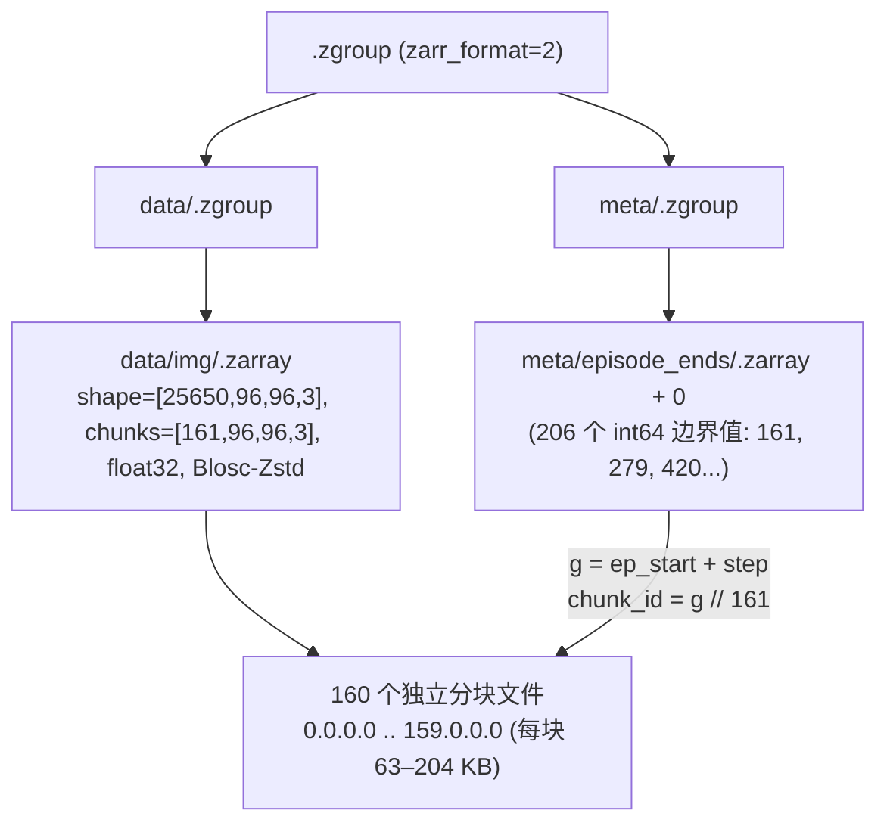

# Zarr / Diffusion Policy 底层架构与二进制机制深度研究

> 基于真实 Columbia Diffusion Policy 官方开源样本 `pusht_cchi_v7_replay.zarr`（与 `lerobot/pusht` 同源：206 条轨迹、25,650 帧、819 个文件、29.57 MB）以及本仓库 [zarr.py](../src/embodied_formats/deep_dive/zarr.py) 的实测输出（运行 `uv run edlab deep zarr -n 60` 或在 VS Code 中按 `F5` 选择 `4. Deep Dive: Zarr / Diffusion Policy` 可一键复现）。

---

## 1. 整体架构：目录树分块数组 + 扁平零拷贝轨迹索引



- **文件系统特征**：同样 25,650 帧，Zarr 展开为 **819 个文件（660 个 `<64 KB`，小文件占比 `80.6%`）**，总计 `29.57 MB`（对比同源 LeRobot v3.0 仅 `15` 个文件、`7.33 MB`）。
- **核心设计哲学**：每个 N 维 Chunk 都是独立的磁盘文件（或 S3/OSS 对象），彻底消除 HDF5 单文件全局锁，天然支持无锁多进程高并发读取；所有轨迹首尾拼接为扁平全局数组，仅靠 `meta/episode_ends` 做虚拟切分。

---

## 2. 全量 160 个 Blosc Chunk 二进制头扫描

每个 Chunk 文件前 **16 字节**是标准 Blosc 二进制头（`<BBBBIII`），如 `data/img/0.0.0.0`：
```text
02 01 94 04 | 00 B0 0F 01 | 00 00 04 00 | 4D AB 02 00
ver=2 lz=1 flags=0x94 typesize=4 | nbytes=17,805,312 (16.98 MB) | blocksize=262,144 | cbytes=174,925 (170.83 KB)
```

**全量扫描 `data/img` 全部 160 个分块的实测结果**：
- **数据类型细节**：图像竟以 **`float32` (`typesize=4`)** 存储（而非 `uint8`），导致逻辑未压缩体积高达 **`2.65 GB`**！
- **Blosc 压缩参数**：`flags = 0x94`（**`bit_shuffle = True`**、`byteshuffle = False`）、`cname = zstd (clevel=5)`、`blocksize = 256 KB`。
- **压缩效率**：`2.65 GB → 28.41 MB`，总压缩比 **`95.63x`**（单块最小 `85.19x`、中位数 `94.76x`、最大 `275.32x`；单块磁盘大小 `63.16 KB – 204.10 KB`）。

---

## 3. Chunk 边界错位与 `161x` 读放大陷阱（核心性能剖析）

实测 `analyze_chunk_alignment_and_read_amp()` 暴露了一个极易被忽视的工程陷阱：
- 该数据集创建时直接把第 0 条轨迹的长度 **`161`** 设成了 `chunks[0]`（`chunks = [161, 96, 96, 3]`），导致：
  1. **`151 / 206` 条轨迹（`73.3%`）跨越了物理 Chunk 边界**；
  2. 单帧逻辑大小 `108.00 KB`，但单个 Chunk 未压缩高达 **`16.98 MB`**；
  3. **随机抽 1 帧时，Zarr 必须整块解压 `16.98 MB`（161 帧）再丢弃其余 160 帧——读放大高达 `161x`！**

### 随机读与无锁多进程扩展实测

| 测试项 | 吞吐 (samples/s) | 延迟 / 有效带宽 | 说明 |
| --- | ---: | ---: | --- |
| 顺序逐帧读 (`1-by-1`) | `380.3` | — | 每次索引仍触发 chunk 缓存/解压 |
| **随机单步读** | **`363.4`** | **`P50 = 2.74 ms / P99 = 3.30 ms`** | 受 `161x` 读放大拖累，比同源 LeRobot v3.0 AV1 Seek (`1,613 sps / 0.57 ms`) 慢 **4.4x** |
| 无锁多进程 `1 worker` (window) | `254.4` | `26.83 MB/s` | — |
| 无锁多进程 `4 workers` (window) | **`382.4`** | **`40.33 MB/s`** | 无全局锁竞争，但受限于单块 16.98 MB 解压内存带宽 |

> **工程调优启示**：Zarr 的随机读性能极度依赖 `chunks[0]` 选型。高频单帧随机采样应将 `chunks[0]` 设为 `1` 或 `4–8`（换取低读放大，但增加文件数）；若按 `161` 这种大 Chunk 存，训练时更适合先把 Zarr 整体 `[:]` 载入 RAM 当内存 ReplayBuffer 使用（这正是 Diffusion Policy 原版代码在小型数据集上的做法）。

---

## 4. VS Code 单步调试与 Hex Editor 字节对照指南

- **CLI**：`uv run edlab deep zarr -n 60`
- **VS Code `F5` 启动项**：`4. Deep Dive: Zarr / Diffusion Policy (Blosc + Read-Amp + Workers)`
- **推荐断点与 Watch 观察要点**：
  1. `src/embodied_formats/deep_dive/zarr.py` → `scan_blosc_chunks()`
     - **Watch**：`flags` (`0x94`)、`typesize` (`4`, float32!)、`nbytes` (`17805312`)、`cbytes` (`174925`)、`nbytes / cbytes`
     - **观察重点**：看透 Blosc 16 字节二进制头，理解 BitShuffle + Zstd 如何把 2.65 GB float32 图像压成 28.4 MB。
  2. `src/embodied_formats/deep_dive/zarr.py` → `analyze_chunk_alignment_and_read_amp()`
     - **Watch**：`ep_ends[:5]`、`chunk0` (`161`)、`cross_chunk_eps` (`151/206`)、`chunk_uncomp_bytes` (`16.98 MB`)
     - **观察重点**：理解 `chunks[0]` 选型对随机读的致命影响（`161x` 读放大）以及 `meta/episode_ends` 的零拷贝扁平轨迹索引。
  3. `src/embodied_formats/deep_dive/zarr.py` → `profile_zarr_access_and_concurrency()`
     - **Watch**：`rand_ms`、`scaling`
     - **观察重点**：对比单帧随机读（2.74 ms）与无锁多进程扩展行为。
- **Hex Editor / 文本对照**：
  - 文本打开 `data/real/zarr_pusht/pusht_cchi_v7_replay.zarr/data/img/.zarray` 查看 JSON 控制面；
  - Hex Editor 打开 `data/real/zarr_pusht/pusht_cchi_v7_replay.zarr/data/img/0.0.0.0`，对照前 16 字节 `02 01 94 04 00 B0 0F 01 00 00 04 00 4D AB 02 00`。

---

## 5. 固定规范 vs 自定义扩展（字段级全拆解）

### 5.1 Zarr v2 存储规范（绝对固定 — Zarr 协议强制要求）

| 位置 | 固定要素 | 具体含义与系统作用 |
| --- | --- | --- |
| **Group 元数据** | `.zgroup` (`{"zarr_format": 2}`) | 标识当前目录是一个 Zarr Group（如根目录、`data/`、`meta/`）。 |
| **Array 元数据** | `.zarray` JSON（必填：`shape`、`chunks`、`dtype`、`compressor`、`order`、`fill_value`、`filters`、`zarr_format`） | 描述多维数组的逻辑维度、物理分块形状、字节序（如 `"<f4"` / `"<i8"`）和压缩器配置；读取时按 `index // chunk_dim` 直接映射到文件名。 |
| **Attribute 元数据** | `.zattrs` JSON | 可为空 `{}`，用于挂载用户自定义属性。 |
| **Chunk 物理文件命名** | `<c0>.<c1>...`（默认 `.` 分隔，v2 可配 `dimension_separator: "/"`） | 每个分块独立落盘（如 `data/img/0.0.0.0`），天然实现多进程/对象存储无锁并发。 |
| **Blosc 16B 二进制头** | `<BBBBIII` (`version`, `versionlz`, `flags`, `typesize`, `nbytes`, `blocksize`, `cbytes`) | 使用 `numcodecs.Blosc` 时每个 Chunk 文件头部固定为这 16 字节，用于校验与多块并行解压。 |

### 5.2 Diffusion Policy ReplayBuffer 骨架（生态约定）

Zarr 本身只是通用科学计算数组格式（气象/生信也在用），具身智能领域广泛沿用 **Diffusion Policy `ReplayBuffer`** 约定：
- **`data/` Group**：把全部 `N` 条轨迹沿时间轴首尾拼接成连续扁平数组（第一维长度等于总步数 `total_steps`，如 `25650`）；
- **`meta/episode_ends` Array**：固定为 1D `int64`（`"<i8"`）数组，长度为轨迹总数（`206`），第 `i` 个元素表示第 `i` 条轨迹在 `data/` 全局数组中的**结束行号（开区间右端点）**（如 `[161, 279, 420, ...]`）。
  - 第 `i` 条轨迹的切片区间即为 `[episode_ends[i-1], episode_ends[i])`（`i=0` 时起点为 `0`），从而在不切碎物理文件的前提下实现零拷贝虚拟分轨。

### 5.3 完全自定义层（随任务与调优需求自由设定）

- **`data/` 下的数组键名、维度与 `dtype`**：
  - 在 `pusht_cchi_v7_replay.zarr` 中自定义了 `img (25650, 96, 96, 3) float32`、`state (25650, 5) float32`、`action (25650, 2) float32`、`keypoint (25650, 9, 2) float32`、`n_contacts (25650, 1) float32`；
  - 换成真机双臂任务时，开发者可自由改为 `cam_left_rgb (uint8)`、`cam_right_rgb (uint8)`、`robot_eef_pose`、`gripper_width` 等。
- **物理分块 `chunks` 粒度**：
  - 完全由创建者决定（本样本错设为 `161`，导致 `161x` 读放大；若追求高频随机单帧读，通常自定义为 `[1, H, W, 3]` 或 `[4, H, W, 3]`）。
- **压缩器与 Filter 参数**：
  - `cname` 可选 `lz4`（解压极快，适合训练热数据）、`zstd`（高压缩比，适合存储），`shuffle` 可选 `BITSHUFFLE (2)` / `BYTESHUFFLE (1)` / `NOSHUFFLE (0)`，甚至可配合 JPEG 图像编码器存变长字节。

### 5.4 逐字段完整字典（基于真实样本 `pusht_cchi_v7_replay.zarr`）

#### A. 控制面 JSON 文件（`.zgroup` / `.zarray`）逐字段说明
| 文件 / 字段名 | 类型 | 属性 | 具体含义 |
| --- | --- | --- | --- |
| `.zgroup` → `zarr_format` | `int` | 规范固定 | Zarr 协议版本号（固定为 `2`） |
| `.zarray` → `shape` | `list[int]` | 规范固定 | 逻辑数组完整维度（如 `[25650, 96, 96, 3]`） |
| `.zarray` → `chunks` | `list[int]` | 规范固定(值可配) | 单个物理 Chunk 文件的维度切片（如 `[161, 96, 96, 3]`） |
| `.zarray` → `dtype` | `str` | 规范固定(值可配) | NumPy 字节序与类型描述符（`"<f4"`=小端 float32，`"<i8"`=小端 int64） |
| `.zarray` → `compressor` | `dict/null` | 规范固定(值可配) | 压缩器配置（`id="blosc"`, `cname="zstd"`, `clevel=5`, `shuffle=2`, `blocksize=0`） |
| `.zarray` → `order` | `str` | 规范固定 | 内存/磁盘布局顺序（`"C"` 行优先 或 `"F"` 列优先） |
| `.zarray` → `fill_value` | `number/null` | 规范固定 | 未初始化 Chunk 的默认填充值（`0.0` / `0`） |
| `.zarray` → `filters` | `list/null` | 规范固定 | 预编码过滤器链（本样本为 `null`） |

#### B. `meta/` 与 `data/` 数组逐字段说明
| 数组路径 | Dtype & Shape | Chunks | 属性 | 具体含义 |
| --- | --- | --- | --- | --- |
| `meta/episode_ends` | `int64` `(206,)` | `(208,)` | 生态固定 | 每条轨迹在扁平全局数组中的结束行号（开区间右端点：`[161, 279, 420, ...]`） |
| `data/img` | `float32` `(25650, 96, 96, 3)` | `(161, 96, 96, 3)` | 自定义 | 顶视角 96×96 RGB 渲染图像（注意：本样本存为 `float32` 而非 `uint8`） |
| `data/state` | `float32` `(25650, 5)` | `(161, 5)` | 自定义 | 5 维本体与物体状态：`[agent_x, agent_y, block_x, block_y, block_angle]` |
| `data/action` | `float32` `(25650, 2)` | `(161, 2)` | 自定义 | 2 维末端推杆目标位置 `(target_x, target_y)` |
| `data/keypoint` | `float32` `(25650, 9, 2)` | `(161, 9, 2)` | 自定义 | T 型木块上的 9 个 2D 关键点坐标（PushT 几何任务专属观测） |
| `data/n_contacts` | `float32` `(25650, 1)` | `(161, 1)` | 自定义 | 推杆与 T 型木块的接触点数量 |
